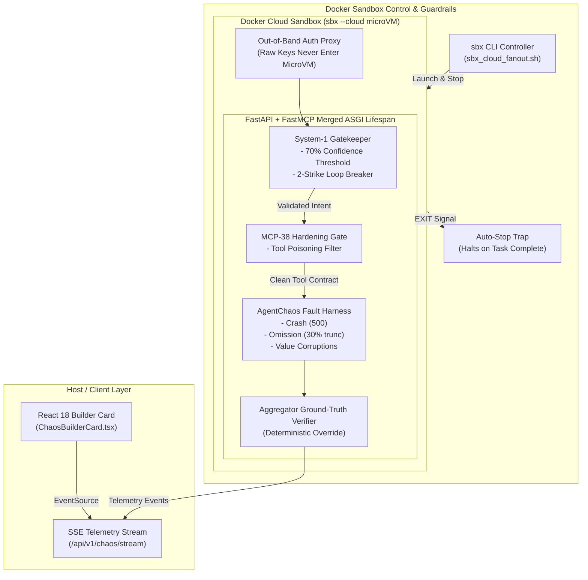

# 🛡️ MCP Chaos Sandbox

> **The Resilience & Fault-Injection Runtime for Autonomous Overnight Agents on Docker Cloud Sandboxes.**  
> Built for the **Docker Agentic Platform $250 Cloud Sandbox Challenge** (*"Build an AI Agent That Works While You Sleep"*).

[](https://www.python.org/downloads/)
[](https://fastapi.tiangolo.com/)
[](https://github.com/jlowin/fastmcp)
[]()
[](https://docs.docker.com/ai/sandboxes/)

---

## 🎯 Executive Summary & The Problem

Most AI agent demos succeed on a local laptop in a single prompt turn, but catastrophically degrade when running unattended in production. Mathematically, an agent step with **95% accuracy** degrades to:

$$\text{Reliability} = 0.95^{10} \approx 59.8\%$$

over a typical 10-step overnight workflow. When models experience transient timeouts, network drops, truncated JSON (`finish_reason: length`), or corrupted tool responses, standard agents enter **infinite retry loops**—silently exhausting compute budgets and API quotas.

**MCP Chaos Sandbox** solves this systems problem by combining:
1. **Isolated Cloud MicroVMs (`sbx --cloud`)**: Hardware-isolated Linux kernels preventing sandbox escapes, with API tokens injected out-of-band via host keychain proxying.
2. **System-1 Confidence Gatekeeper & Loop Breaker**: Intent scoring with a 70% confidence floor and a 2-strike loop breaker to immediately halt and fallback before burning credit.
3. **AgentChaos Fault Injection Harness**: Thread-safe `contextvars`-isolated fault engine that systematically subjects tool calls to **Crash**, **Omission** (30% body truncation with length termination), and **Value** faults under Single, Burst(3), and Intermittent strategies.
4. **MCP-38 Protocol Hardening**: Pre-registration regex and semantic scanning of tool docstrings to block **Tool Description Poisoning** and Cross-Server Prompt Injection.
5. **Stage-Level Ground-Truth Verifier**: Intercepts aggregator-level calculation corruptions and overrides corrupted summaries with deterministic recomputations.
6. **Task-Tied Cost Guardrails**: Incorporates automatic container shutdown hooks (`trap ... EXIT`) so microVMs never idle and burn the $250 challenge credit unattended.

---

## 🏗️ Architecture Overview



---

## ⚡ Key Capabilities

### 1. System-1 Confidence Gatekeeper & 2-Strike Loop Breaker
* **Confidence Floor:** Requests scoring $<0.70$ are routed to deterministic clarification fallbacks without invoking expensive LLM turns.
* **Circuit Breaker:** Tracks consecutive failures per session ID. If two consecutive failures occur (`status >= 500`, `finish_reason == length`, or malformed payload), the circuit trips and executes deterministic fallback routing.

### 2. MCP-38 Docstring Poisoning Protection
Adversarial MCP servers can manipulate tool docstrings to hijack agent execution. The `ToolMetadataContract` strictly validates tool definitions:
* Rejects multi-responsibility tools (`"and"`, `"also"`).
* Blocks unauthorized shell escapes, token leakage attempts, and override instructions (`"ignore previous instructions"`).

### 3. ContextVars-Isolated AgentChaos Harness
The fault injector decorates simulated LLM tool calls with complete execution isolation:
* **Fault Categories:** `NONE`, `CRASH` (500 internal server error), `OMISSION` (truncates string content to 30% and sets `finish_reason: length`), and `VALUE` (arithmetic perturbation).
* **Trigger Strategies:** `SINGLE` (fires on exact call index), `BURST` (fires on $N$ consecutive calls), `INTERMITTENT` (probabilistic), and `PERSISTENT`.

### 4. Cost-Control Guardrails for Docker Cloud Sandboxes
Following official challenge best practices, `backend/sbx_cloud_fanout.sh` guarantees zero idle credit burn:
* Execution is wrapped in bash traps: `trap 'sbx --cloud stop $SANDBOX_PROD' EXIT`
* MicroVM automatically halts compute billing the millisecond test suites or agent workflows conclude.

---

## 🧪 Verification & Test Suite

All 4 test scenarios pass deterministically with zero third-party async dependencies:

```bash
# Run pytest verification
pytest backend/test_chaos_sandbox.py -v
```

### Verified Test Matrix:
| Test Name | Target Behavior | Outcome |
|---|---|---|
| `test_mcp38_docstring_poisoning_blocked` | Rejects adversarial / multi-intent tool docstrings | ✅ PASSED |
| `test_system1_gatekeeper_confidence_and_loop_breaker` | Enforces 70% threshold and trips circuit on 2 strikes | ✅ PASSED |
| `test_omission_fault_truncates_to_30_percent` | Injects 30% truncation + forces `finish_reason='length'` | ✅ PASSED |
| `test_burst_strategy_fires_three_consecutive_calls` | Exercises Burst(3) on calls 2, 3, 4 while keeping 1 & 5 clean | ✅ PASSED |

---

## 🚀 Quickstart & Reproducibility Guide

### Local Reproduction (No Docker or Cloud Credit Required)

1. **Clone the repository:**
   ```bash
   git clone https://github.com/Viditya/mcp-chaos-sandbox.git
   cd mcp-chaos-sandbox
   ```

2. **Set up Python environment (Python 3.11+):**
   ```bash
   python -m venv .venv
   # Windows:
   .venv\Scripts\activate
   # Linux/macOS:
   source .venv/bin/activate

   pip install -r backend/requirements.txt
   ```

3. **Run the test suite:**
   ```bash
   pytest backend/test_chaos_sandbox.py -v
   ```

4. **Start the FastAPI + FastMCP ASGI server:**
   ```bash
   uvicorn backend.main:app --host 127.0.0.1 --port 8000 --reload
   ```
   * Health Check: `http://127.0.0.1:8000/health`
   * SSE Stream: `http://127.0.0.1:8000/api/v1/chaos/stream`
   * OpenAPI Specs: `http://127.0.0.1:8000/docs`

---

### Docker Cloud Sandboxes Reproduction

1. **Authenticate the `sbx` CLI:**
   ```bash
   chmod +x backend/sbx_cloud_fanout.sh
   ./backend/sbx_cloud_fanout.sh init-secrets
   ```

2. **Launch Cloud MicroVM & Attach Telemetry Volume:**
   ```bash
   ./backend/sbx_cloud_fanout.sh launch-prod
   ```

3. **Run Overnight Resilience Suite with Auto-Stop Cost Guardrail:**
   ```bash
   ./backend/sbx_cloud_fanout.sh run-overnight-suite
   ```

4. **Verify MicroVM State & Billing Protection:**
   ```bash
   ./backend/sbx_cloud_fanout.sh status
   ```

---

## 💰 Challenge Credit Budget & Math

* **Challenge Allocation:** $250.00
* **Docker Cloud Tier:** 2 vCPU, 4 GiB RAM @ **$0.14 / hour**
* **Total Available Unattended Compute:** **~1,785 hours**
* **Guaranteed Zero-Idle Billing:** Enforced via `sbx_cloud_fanout.sh` auto-stop traps to ensure that stopped microVMs retain state without incurring ongoing compute charges.

---

## 👥 Authors & Acknowledgments

* **Viditya Tyagi** ([@Viditya](https://github.com/Viditya)) — Architecture, Gatekeeper, Fault Harness & Cloud Orchestration.
* **Challenge Context:** Built for the [Collabnix / Docker Agentic Platform $250 Cloud Sandbox Challenge](https://github.com/ajeetraina/250-dollar-agent-challenge) hosted by Ajeet Raina.
